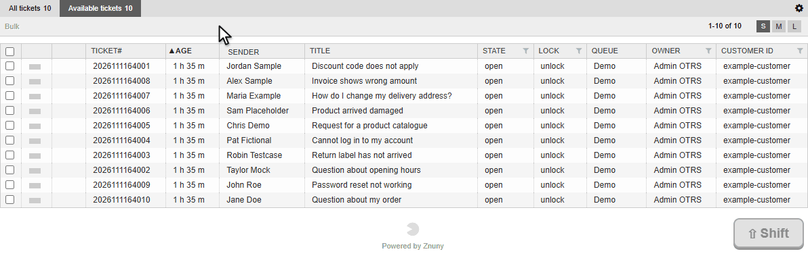

# ShiftSelect

Shift+click range selection of ticket checkboxes in the ticket overviews of Znuny LTS 6.5.

[](https://www.gnu.org/licenses/gpl-3.0)
[](https://www.znuny.org/)

> **Maintenance status:** This package is published as-is, in case it is useful to others. It is not actively maintained. Pull requests are not accepted. Questions and ideas are welcome in [Discussions](../../discussions); bug reports in Issues may go unanswered for a long time. You are welcome to fork it and make it your own (GPLv3).



## What it does

In a Znuny ticket overview every checkbox has to be clicked on its own. With ShiftSelect an agent clicks one checkbox, holds Shift and clicks another one further down the list, and all checkboxes between the two (inclusive) are set in one go, as in Gmail and similar apps. Clicking the second checkbox to uncheck it clears the whole range instead.

The anchor is always the last checkbox that was clicked, whether it was checked or unchecked. Check A, uncheck A, then Shift+click C: the range A to C is checked.

It works in every overview that uses core's `.Overview` container in the Small, Medium and Large views: queue view, search results, status view, escalation view, locked tickets and so on. The script is loaded for the whole agent interface, not for a single page.

The package is client side only. It has no database effect and no Perl code.

## Requirements

- Znuny LTS 6.5.x. Running in production on 6.5.26. It has not been tested on Znuny 7.x.
- A modern web browser. Internet Explorer is not supported.

## Installation

Download `ShiftSelect-1.0.0.opm` from the Releases page. Install it from the command line and restart the web server so the new configuration is loaded:

```shell
sudo -u otrs /opt/otrs/bin/otrs.Console.pl Admin::Package::Install /path/to/ShiftSelect-1.0.0.opm
sudo systemctl restart apache2
```

Installing through **Admin → Package Manager** works as well. Remove the package with `Admin::Package::Uninstall ShiftSelect`. Uninstalling removes all files and the setting; the package creates no database tables and needs no manual steps.

To build the package yourself, point `--module-directory` at `src/` so the package contains the files in the repository and not whatever is already installed:

```shell
sudo -u otrs /opt/otrs/bin/otrs.Console.pl Dev::Package::Build \
    --module-directory /path/to/repo/src \
    /path/to/repo/src/ShiftSelect.sopm /output/dir/
```

## How it works

Two parts. No core file is changed or overridden.

- `src/Kernel/Config/Files/XML/ShiftSelect.xml` registers the script through the SysConfig setting `Loader::Agent::CommonJS###100-ShiftSelect`, the same mechanism core uses for its own `Core.*.js` files.
- `src/var/httpd/htdocs/js/ShiftSelect.js` listens for clicks on `input[name=TicketID]`. It remembers the last checkbox that was clicked. On a Shift+click it sets every checkbox between that one and the clicked one to the new state of the clicked one.

Details:

- The listener is a native `document.addEventListener(..., true)`, which runs in the capture phase. `Core.UI.ActionRow` binds a handler on every checkbox that calls `stopPropagation()`, so a delegated listener in the bubble phase (for example jQuery `.on()`) would never see the click.
- The other checkboxes are changed with `.prop('checked', ...).triggerHandler('click')`, the same pattern as core's `SelectAllTickets`. That way the action row and the bulk action toolbar update as they do after a normal click.
- A range never crosses overview boundaries. The checkboxes are collected from the `.Overview` container that holds the clicked checkbox, so a Shift+click between two different overview tables on one page does nothing beyond a normal click.

## AI assistance

ShiftSelect was written with Claude Code (Anthropic) as a pair-programming assistant: the design, the JavaScript code and this documentation were drafted together with it.

The maintainer reviewed every change and is responsible for the result. There is no unit test. The package runs in production on Znuny 6.5.26 and was verified manually there. It has not been tested on Znuny 7.x.

## License

Copyright (C) 2026 Katla

GNU General Public License, version 3. See [COPYING](COPYING).
